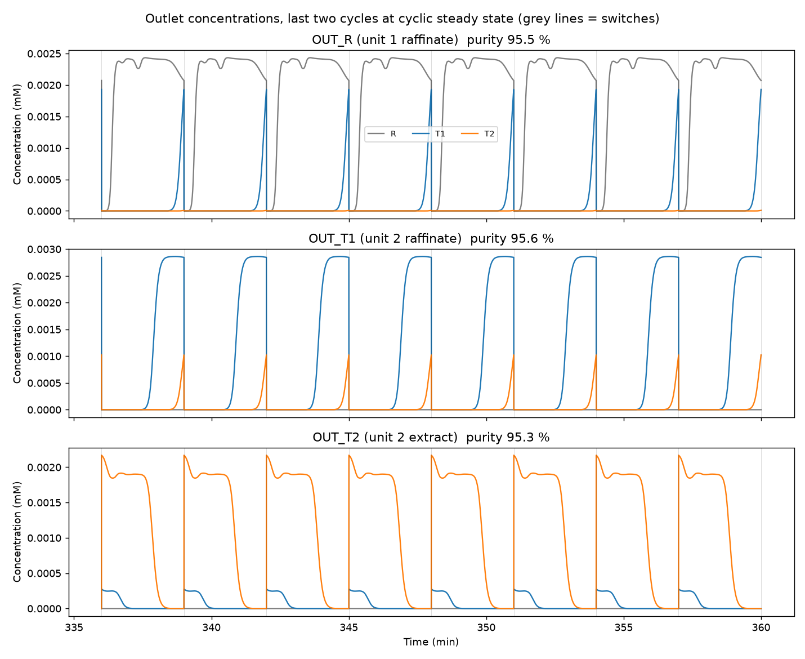
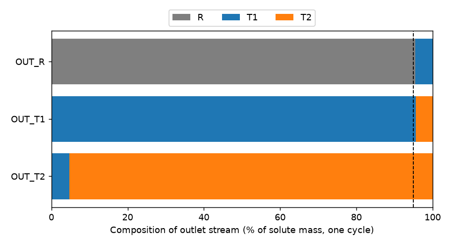

# Ternary SMB cascade in CADET: two coupled 4-zone units

An isocratic separation of one raffinate impurity and two overlapping targets. It uses two classic
4-zone SMB units (one column per zone, as in the CADET tutorial) coupled in sequence:

```
FEED ─► unit 1 (R | T1+T2) ─ raffinate ─► OUT_R
                           └ extract ───► unit 2 feed port (T1 | T2) ─ raffinate ─► OUT_T1
                                                                     └ extract ───► OUT_T2
ELUENT ─► zone I of both units
```

The model uses 2 inlets (feed and one shared eluent), 8 columns (LRM without pores, ε = 0.83,
n_col = 40, linear isotherm, `is_kinetic = 0`) and 3 outlets. Units: 0 FEED, 1 ELUENT, 2 OUT_R,
3 OUT_T1, 4 OUT_T2, 5–8 unit-1 columns, 9–12 unit-2 columns.

| component | ka | kd | H = ka/kd | outlet |
|---|---|---|---|---|
| R (impurity, barely binds) | 0.6  | 2.0 | 0.3 | `OUT_R` |
| T1 | 9.0  | 1.5 | 6.0 | `OUT_T1` |
| T2 | 9.24 | 1.2 | 7.7 | `OUT_T2` |

- T1 and T2 differ by 1.7 in H (selectivity 1.28), so there's no clean cut between them.
- T1 sits 5.7 above R.
- Feed is 0.003 mM of each component.

### Same rate in both units

- Both units switch together every 180 s.
- Unit 1's extract flows straight into unit 2's feed port, so the two flows must match:
  `(m_I − m_II)₁ · V₁ = (m_III − m_II)₂ · V₂`.
- Unit 2 keeps the tutorial columns (L = 25 cm, D = 2 cm).
- Unit 1's column volume comes out of the flow match above, at the tutorial's length-to-diameter
  ratio of 12.5.
- Because the R split is easy, unit 1 ends up with much smaller columns.

## Result

CMA-ES over the 8 zone flow-rate ratios. It maximizes fresh-feed throughput subject to every outlet
being at least 95 % pure, with a small penalty on eluent use. Results are at cyclic steady state,
last of 30 cycles, n_col = 40:

| | start (linear SMB theory) | **optimized** |
|---|---|---|
| OUT_R purity | 100 % | **95.5 %** |
| OUT_T1 purity | 99.7 % | **95.6 %** |
| OUT_T2 purity | 99.9 % | **95.3 %** |
| feed throughput | 2.78e-8 m³/s | **1.36e-7 m³/s (4.9×)** |
| eluent / feed | 15.1 | **5.5** |
| unit-1 columns | 12.5 cm × 1.00 cm (9.8 mL) | **18.4 cm × 1.47 cm (31.2 mL, 40 % of unit 2)** |
| recovery R / T1 / T2 | 99.9 / 100 / 99.8 % | 100 / **90.7** / 95.8 % |

Mass balance closes to within 0.1 %. At n_col = 80 the optimized design gives 96.3 / 97.3 / 97.2 %
(`results/mesh80/`), so the 40-cell numbers are conservative.

Optimized zone flow-rate ratios, `m = (Q·t_s − V·ε) / (V·(1−ε))`:

| | m_I | m_II | m_III | m_IV |
|---|---|---|---|---|
| unit 1 | 8.59 | 1.55 | 6.17 | −0.59 |
| unit 2 | 9.34 | 4.95 | 7.75 | 2.89 |

`results/cascade_opt_connections.txt` has every flow and the full CADET connection matrices.





**What the optimizer did:** it used up the 5 % impurity allowance to gain throughput. Ideal linear
SMB theory says that for clean splits, unit 1 zone III should stay below H_T1 = 6.0, and unit 2
zones II and III should stay inside [6.0, 7.7]. The optimizer went past both:
- In unit 1, some T1 is let into the R outlet.
- In unit 2, some T1 goes to the T2 outlet and some T2 to the T1 outlet.

All three purities end up pinned at about 95.5 %, and T1 recovery drops to 90.7 %. If recovery matters,
add a recovery constraint to `objective()` in `optimize.py`.

## Caveats

- Band broadening comes almost entirely from the n_col = 40 grid, because axial dispersion is
  near zero and there's no mass-transfer resistance. Purities depend on the mesh (see the 80-cell
  check). Add real dispersion and mass-transfer data before trusting the margins.
- With no pressure drop and no physical dispersion in the model, only unit 1's column **volume**
  matters. The length-to-diameter ratio is held at the tutorial's 12.5; a pressure-drop limit would
  be needed to choose it.
- The direct extract-to-feed coupling assumes both units switch at the same instants. A buffer tank
  between them would loosen that requirement but isn't modeled.

## Running

```bash
python3 -m venv .venv && .venv/bin/pip install cadet-core cadet-python numpy scipy matplotlib cma
```

Optimize, starting from the linear-theory design (about 25 min with 9 workers):

```bash
.venv/bin/python optimize.py --out results/cascade_opt.json
```

Validate at full fidelity and write plots and connection matrices:

```bash
.venv/bin/python report.py results/cascade_opt.json --ncol 40 --cycles 30
```

- `smb_cascade.py`: CADET model of the coupled units, plus the purity, recovery and mass-balance
  calculation at cyclic steady state.
- `optimize.py`: CMA-ES over the zone flow-rate ratios. It runs in parallel, one cadet-cli process
  per evaluation, about 7 s each at n_col = 40 and 12 cycles.
- `report.py`: full-fidelity re-simulation, plots and connection dump.

## Project history

**Previous experiment: 4 components in one 4-column unit** (code and results at commit `7c1a25e`).
- **Setup:** R plus three targets with H = 0.25 / 2.5 / 5 / 10, 2 inlets, 4 columns and 4 outlets.
  Only the connection matrices were optimized.
- **Result:** a schedule giving 96.1 / 96.0 / 96.6 / 99.96 % purity at 1.27e-7 m³/s feed.
- **What the optimizer chose:** every column sent its whole outflow to its own outlet, so the process
  behaved like sequential SMB rather than a counter-current ring.
- **What it taught:** CMA-ES from a naive start got stuck at about 74 % worst-case purity. Starting
  from a design based on retention volumes, then refining with the optimizer, is what worked. The same
  approach is used here, starting from linear SMB theory.
